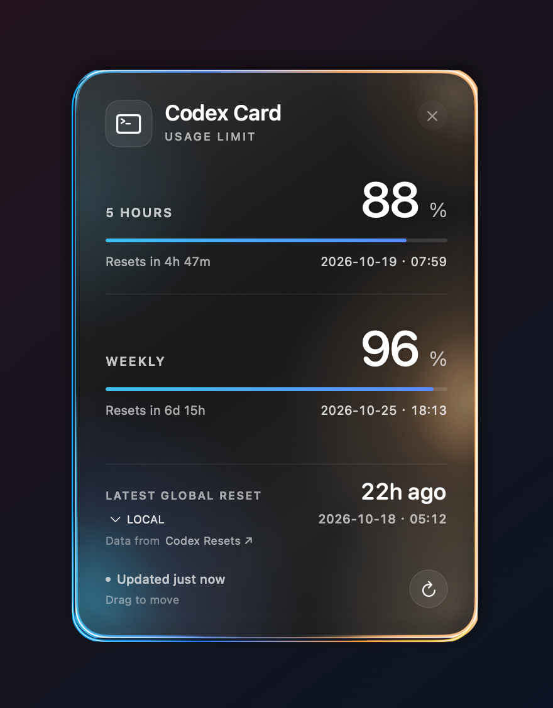
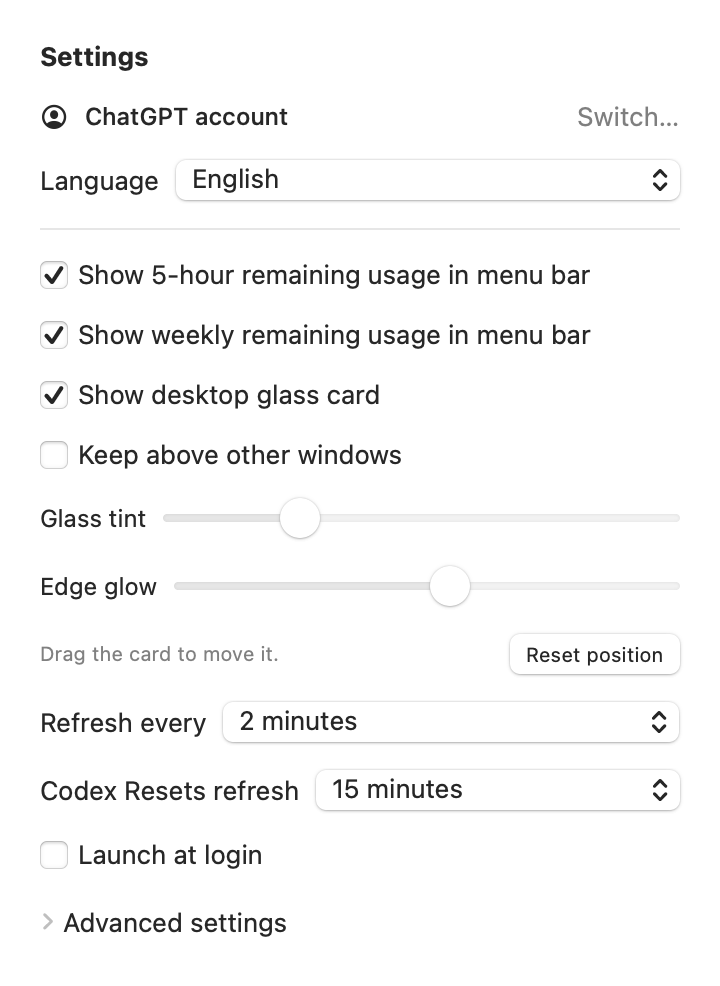
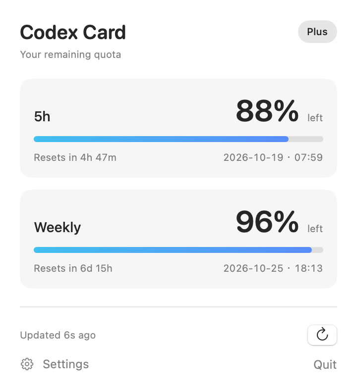

# Codex Card

Your Codex usage limits, on your desktop and in the macOS menu bar.

<p align="center">
  
</p>

<p align="center">Native desktop card preview, rendered from a real cached quota snapshot on a test backdrop.</p>

## Project status

Native macOS MVP. Requires macOS 15+ and a ChatGPT-backed Codex login. Codex CLI 0.160.0 is included; no separate CLI installation is needed.

## Download and install / 下载与安装

Download the appropriate DMG from this repository's **Releases** page:

| Mac | Download |
| --- | --- |
| Apple Silicon (M series) | `Codex-Card-Apple-Silicon.dmg` |
| Intel | `Codex-Card-Intel.dmg` |

1. Open the downloaded DMG.
2. Drag **Codex Card** into **Applications**.
3. Launch **Codex Card**. If prompted, sign in with your ChatGPT account in the browser.
4. Open the menu bar panel to view your remaining quota and settings.

Requires macOS 15.0 or later. Each download contains only its matching architecture, including the bundled Codex CLI. These builds are ad-hoc signed and **not notarized by Apple**.

从本仓库的 **Releases** 页面下载对应安装包：M 系列 Mac 选择 `Apple-Silicon`，Intel Mac 选择 `Intel`。打开 DMG，将 **Codex Card** 拖入“应用程序”，然后启动；如有提示，在浏览器中登录 ChatGPT。点击菜单栏中的额度即可打开面板和设置。

需要 macOS 15.0 或更高版本，无需单独安装 Codex CLI。当前安装包为本地临时签名，**尚未经过 Apple 公证**，macOS 可能显示安全提示。

## Language / 语言

Choose **Settings → Language → Follow system, English, or 简体中文**. Changes apply immediately and are saved for the next launch. Account actions appear at the top of Settings; executable and path options are in the collapsed **Advanced settings** section.

在“**设置 → 语言**”中选择“跟随系统”、English 或“简体中文”，切换立即生效并自动保存。账户入口位于设置顶部，可执行文件与路径选项位于默认折叠的“高级设置”中。

<p align="center">
  
</p>

Current settings view rendered from the app code, showing the language selector, account row, and collapsed Advanced settings.

## Menu bar quota view

`5H 72% · 7D 61%` — remaining quota, at a glance. These percentages are examples; your menu bar shows your account's latest reported limits.

<p align="center">
  
</p>

## Scope

A native macOS 15+ menu bar app focused on Codex usage limits.

- Swift 6 and SwiftUI, with AppKit where needed.
- `MenuBarExtra` for the menu bar interface.
- Codex CLI app-server JSON-RPC for structured usage data.
- Remaining quota and reset countdowns, with exact local dates and times aligned at the right.
- Quota colors: blue above 25% remaining, orange at 11–25%, red at 10% or less.
- Manual refresh and automatic refresh every 1, 2, 5 or 10 minutes.
- Launch at login (off until you enable it).
- Multiple Codex quota buckets and missing-window handling.
- Cached last reading, with a visible stale-data indicator (`~` in the menu bar).
- Bundled Codex CLI matching the app architecture, with an optional custom executable path.
- English and Simplified Chinese, with an in-app language selector.
- Optional draggable desktop glass card, drawn entirely in SwiftUI and AppKit.
- Frosted glass with blue left-edge highlights and inward diffusion, with warm right-edge highlights, adjustable edge glow and tint, and an optional always-on-top mode.
- Latest global reset announcement from [Codex Resets](https://codex-resets.com), with local / Tibo time.
- Offset front and rear glass edges reveal thickness along the left and bottom.
- Saved card position, with recovery when a display is disconnected.

## Desktop glass card

Open **Settings → Show desktop glass card**. Drag the card's background to any
position; Codex Card remembers where you leave it. The card shares the menu bar's
live quota data and refresh schedule. Its × button hides it, and it can be shown
again from Settings. **Edge glow** adjusts the halo strength; **Glass tint**
adjusts a smoked-glass layer with a minimum optical density to keep light wallpaper from washing out the face. Both settings are saved. **Reset position** returns it to the top-right of the screen.

The card and its lighting are pure code, with a transparent window and native
behind-window material. This image is an offscreen render on a test backdrop,
not a desktop screenshot. No generated background image is used by the app.
Reduce Transparency and Increased Contrast use a solid surface for readability.

For a temporary developer preview without changing the saved visibility preference:

```sh
open -n "/Applications/Codex Card.app" --args --preview-desktop-card
```

To regenerate native PNG previews from the latest cached quota data:

```sh
bash Scripts/render-previews.sh /tmp/codexbar-previews
```

The compact announcement strip below the quotas shows the latest executed
regular or banked reset tracked by [Codex Resets](https://codex-resets.com).
It is a global announcement, independent of your account's scheduled quota resets.
Use **LOCAL / TIBO** to choose the announcement time zone; Tibo uses
`America/Los_Angeles`, including daylight saving. Personal quota dates remain local.

The public `/api/v1/status` endpoint needs no API key. It is checked every 15
minutes by default (5 or 10 minutes can be selected in Settings), supports conditional ETag refresh, and caches the last successful reading.
The refresh button also updates announcements. Offline readings are marked
**Cached**. Scheduled announcements and AI forecasts are not treated as executed
resets. The card credits the source with a link as requested by its
[API documentation](https://codex-resets.com/api/docs).

## Build and run

Install Xcode 26+ and [XcodeGen](https://github.com/yonaskolb/XcodeGen), then:

```sh
bash Scripts/fetch-cli.sh
xcodegen generate
xcodebuild -project CodexBar.xcodeproj -scheme CodexBar \
  -configuration Release -destination 'generic/platform=macOS' -derivedDataPath build build
open "build/Build/Products/Release/Codex Card.app"
```

Alternatively, open `CodexBar.xcodeproj` in Xcode and run the CodexBar scheme.
The internal Xcode project and scheme retain the name `CodexBar`; the built application is `Codex Card.app`. The app lives in the menu bar and does not show a Dock icon.

To build separate Apple Silicon and Intel local apps and DMGs:

```sh
bash Scripts/package.sh
```

Outputs are `dist/Codex-Card-Apple-Silicon.dmg` and `dist/Codex-Card-Intel.dmg`, with apps in `dist/arm64/` and `dist/x86_64/`. Build only one with `bash Scripts/package.sh arm64` or `bash Scripts/package.sh x86_64`. Both the app and bundled CLI contain only the selected architecture.

Codex Card invokes its bundled `codex app-server --stdio`, completes its
initialization handshake, and calls `account/rateLimits/read`. It does not start
a model turn. The CLI manages authentication; no API key entry is needed here.
At startup Codex Card first reads your existing Codex login. A working login goes straight to quota display. Only an authentication failure opens the sign-in guide: choose **Sign in with ChatGPT**, finish the official browser flow, and return to Codex Card. Network failures retain cached quota without asking you to sign in again. You can reopen the guide from Settings.

Settings → Advanced settings can optionally override the bundled executable with an absolute path. Clearing the path restores the bundled CLI. The CLI manages credentials; Codex Card never stores authorization URLs or passwords.

## Tests

```sh
xcodebuild -project CodexBar.xcodeproj -scheme CodexBar \
  -destination 'platform=macOS' -derivedDataPath build test
```

Tests use local fake app servers, not your account. They cover the protocol
handshake, streamed responses, login errors, timeout, cancellation, percentage
semantics, window labels, multiple buckets, and stale/reset behavior.

## Data and distribution

Preferences and the latest quota snapshot are stored locally in UserDefaults.
Codex Card does not store credentials, collect analytics or upload usage history.
Closing the popover keeps refresh active. Refresh pauses while the screen is locked or the Mac is asleep, then resumes after unlock or wake. Failed refreshes retain the previous timestamp.

The app is intentionally not App Sandbox enabled because it launches the local
Codex CLI. Builds use ad-hoc signing for local development. The current DMGs are ad-hoc signed and **have not been notarized by Apple**. macOS may display a security warning. Developer ID signing and notarization have not been verified for these downloads.

Running `bash Scripts/package.sh` produces separate ad-hoc DMGs for local distribution. The bundled CLI increases the download size; binaries are pinned and hash-checked by `Scripts/fetch-cli.sh`, and their Apache 2.0 license and NOTICE ship with the app.

## License

MIT. Built with Codex to monitor Codex.

Usage integration reference: [Codex App Server documentation](https://developers.openai.com/codex/app-server).

Window labels follow the returned window durations. Missing data is shown as
unavailable, and stale data is identified explicitly. Reset times never imply
that quota has recovered without a fresh server reading.

Authentication remains managed by Codex; credentials must not be committed.
